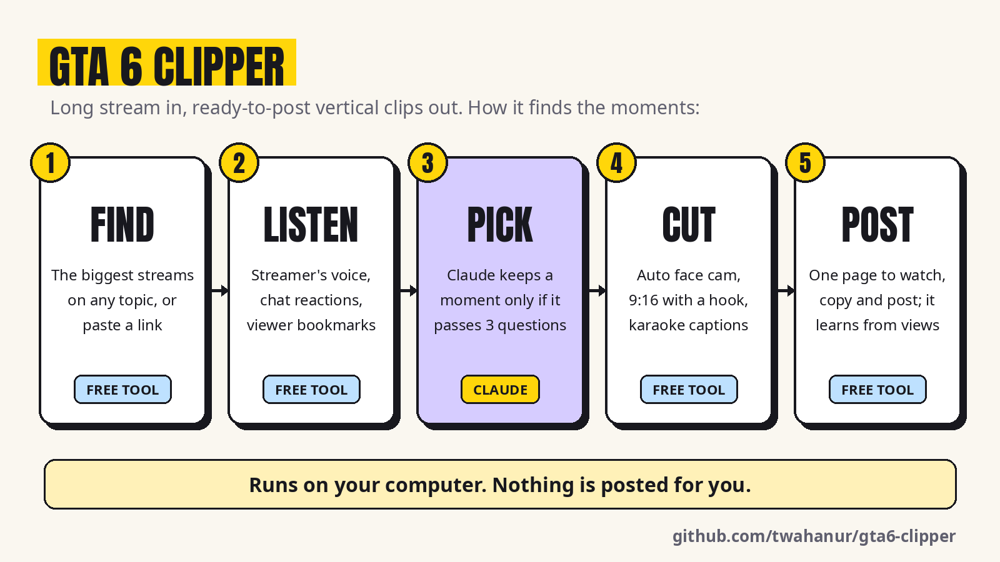

# GTA Clipper

A free [Claude Code](https://claude.com/claude-code) skill that turns any long stream, podcast or video into ready-to-post vertical clips. It was built for GTA 6 streams, and it works the same on any game, IRL and Just Chatting streams, podcasts and interviews.

Give Claude a link, or ask it to find today's biggest streams on any topic. It listens to the whole stream, picks the best moments with a harsh filter, and cuts 9:16 clips with the face cam on top and the main video underneath (or one clean crop when there's no face cam, like most podcasts), a hook and word-by-word captions. Then it opens one page where you watch, copy the caption and post.

In testing, an hour-long stream turned into 3 ready-to-post clips in about 13 minutes on a MacBook.



Based on [Clipper](https://github.com/raycfu/clipper) by Ray Fu ([@raycfu](https://www.instagram.com/raycfu)), MIT licensed. This version adds sound-event detection and a numbered videos folder.

## What's new in this version

- **Picks real moments, not random ones.** The analyzer was rebuilt after studying an 11-hour stream where the old picks felt random. Three things were wrong: chat speed was mostly "hi" floods, "I was here", lag complaints and polls; YouTube chat reacts 20 to 35 seconds after the moment, so clips started after it was over; and game sounds like a hovering helicopter outranked the streamer actually reacting. Now chat counts only reactions (laughing, shock, fails, hype, emoji included), its delay is measured and shifted back for every stream, the streamer's own voice (yelling and laughing above their normal) is a main signal, and everything is scored per second. Each candidate tells Claude the exact MOMENT, what chat said about it and a suggested cut, and Claude builds the clip around that moment.
- **It hears what's happening, not just how loud it is.** A free sound classifier ([YAMNet](https://huggingface.co/andrelgomes/yamnet-onnx), runs on your computer, ~16 MB) scores every second of every stream for action (gunfire, explosions, crashes, skids, sirens, helicopters) and reactions (screams, shouts, laughter). Plain talking with no action, like a game cutscene, scores lower, so cutscenes stop beating real moments. An 11-hour stream takes about 2 extra minutes.
- **Reaction and game words.** Every window gets a bonus for words like "oh my god", "bro what", "no no no". When the title names a game, that game's words count too (GTA: cops, wanted, wasted, busted, heist, chase, crash...). Add your own game in `scripts/profiles.py`.
- **Chat replay retry.** Long chat replays that cut off halfway get downloaded again.
- **40 candidates** instead of 25, listed strongest first, each with what the sound classifier heard.
- **All clips in one folder, numbered.** Every finished clip is also copied to `~/Clipper/videos/` as `001_<hook>.mp4`, `002_...`, continuing across every stream you clip. A re-rendered clip keeps its number.

- **Captions in any script, karaoke style.** Bangla, Hindi, Arabic, Tamil, Thai and more render correctly (a free Noto font downloads itself when a clip needs it), and the word being said lights up yellow. Before this, Bangla and Hindi captions lost their vowel signs.
- **Bangla and Hindi reaction words, and 10 games.** "কি হলো", "क्या हुआ", "ki holo" count as reactions. Game word lists for GTA, Valorant, CS2, Fortnite, Minecraft, Free Fire, PUBG/BGMI, Warzone, Apex and FIFA/EA FC.
- **GPU support.** With an NVIDIA GPU, Whisper runs on it automatically (setup installs the CUDA libraries). Without one, nothing changes.

- **Premium analysis extras.** Viewer timestamps from the top comments (weighted by likes), an optional `--visual` pass that watches a 144p copy for motion bursts (and flags screens going dark or gray, like death screens), a guess at each moment's kind, long "arc" moments flagged for longer clips, an interactive `report.html` with every signal on a timeline, and saved transcripts so re-runs are fast.

- **Measured, and learning.** `benchmark.py` scores the analyzer against moments people actually liked: on the test stream 6 to 8 of its top 10 were moments viewers had bookmarked, against 2 for the old analyzer and 1 for random picks. `learn.py` now turns your Shorts' views into signal weights the next analysis uses.
- **Twitch community clips** (official API, your own free Twitch app), **already-clipped detection** (`fingerprint.py` finds Shorts others posted from the stream by audio fingerprint), **music/copyright warnings**, **cuts on sentence boundaries** and a **face cam detector** that pre-fills each clip's layout.
- **Layouts that follow the video.** The face cam detector handles cut-out streamers and two-person cams, and splits a clip where the layout changes (gameplay, then a camera shot), rendering each part in its own layout. Wide face cams are shown whole instead of cropped, and `--facecam off` drops the face cam band and fits the whole picture instead.
- **`--deep`**: voice separation (Demucs) to hear laughing and yelling under the game audio, and speaker diarization for podcasts. **`live.py`**: finds moments while a stream is still live.

## What you need

- A Mac or Linux computer. On Windows, run Claude Code inside [WSL](https://learn.microsoft.com/windows/wsl/install).
- [Claude Code](https://claude.com/claude-code), which comes with the Claude Pro plan ($20/month).
- About 3 GB of free space for the tools and speech models, plus room for the streams you clip (a few hundred MB each).

Everything else is free and installs itself the first time: yt-dlp, ffmpeg, Whisper (speech to text that runs on your own computer), deno and a caption font. Nothing is installed system-wide. It all lives in `~/.clipper`.

## Install

```bash
git clone https://github.com/twahanur/gta-clipper ~/.claude/skills/gta-clipper
```

No git? Click **Code → Download ZIP** above, unzip it, rename the folder to `gta-clipper` and move it into `~/.claude/skills/`. On a Mac that folder is hidden: in Finder press `Cmd + Shift + G`, paste `~/.claude/skills/` and press Enter.

Then open Claude Code (in the terminal, or the Code tab of the Claude desktop app) and say:

> set up the clipper

Setup takes about 5 minutes the first time and ends with `READY`. Allow the commands when Claude asks.

## Use it

Say one of these to Claude:

| Say | What happens |
|---|---|
| `clip this stream: <link>` | Clips a finished YouTube, Twitch or Kick stream, a podcast or any long video |
| `find me today's biggest GTA 6 streams and clip them` | Finds the most viewed streams first, then clips them. Swap GTA 6 for any game, streamer or topic |
| `find me this week's biggest podcast episodes and clip them` | Same thing for podcasts |
| `make the hook for clip 2 shorter` | Changes one clip and re-renders only that one |
| `clip 3 starts slow, start it 4 seconds later` | Re-cuts one clip |
| `look at what's working` | Weekly report from your posted Shorts' views (give it your channel link) |

Claude shows you a table of the moments it kept and the ones it cut, with a reason for each, then renders the clips and opens the gallery page. Clips are saved in `~/Clipper/videos/` (numbered 001, 002, ...) and in `~/Clipper/runs/<date>/clips/`.

## How it works

1. **Find**: searches YouTube for the most viewed long streams or videos on your topic. Streams that are still live are skipped until the recording is up.
2. **Listen**: downloads only the audio, then scores every second from the streamer's voice (yelling and laughing above their own normal), laughs and screams, the moment a game sound starts, YouTube's "most replayed" graph and, on YouTube stream recordings with chat replay, real chat reactions shifted back by chat's measured delay. It transcribes 70 seconds around the 40 strongest moments with Whisper on your computer, with what chat said and a suggested cut for each.
3. **Pick**: Claude scores every moment with three questions. Would a stranger stop scrolling in two seconds? Does it make sense with zero context? Does it pay off inside the clip? One no and it's cut.
4. **Cut**: downloads only the minutes each clip needs and builds a 1080x1920 video: face cam on top and the main video underneath (or one full-frame crop when there's no face cam), a hook for the first 3 seconds, word-by-word karaoke captions in the streamer's own script and audio at Shorts loudness. Claude checks three frames of every clip and trims around any layout switch in the stream, and every clip is checked for length, a black face cam and missing captions.
5. **Post**: one page with every clip, a title, caption and hashtags with copy buttons, and a link to the exact second in the original stream so you can credit it. Nothing is ever posted for you.

Every week, `look at what's working` reads the public views on your Shorts, matches them to the clips the skill made, and updates `~/Clipper/preferences.md`, so the picks lean toward what your audience actually watches. It needs about 10 posted Shorts, and it only matches Shorts whose title still contains the clip's title or hook.

## Before you post

- Watch every clip first.
- Add something of your own: your hook, your take or a reaction. Channels of raw reposted clips get turned down for monetization.
- Credit the streamer or creator, follow the clipping campaign's rules, and don't post the same clip twice on one account.
- Only clip streams you're allowed to clip. You're responsible for what you post.

## Update

```bash
cd ~/.claude/skills/gta-clipper && git pull
```

Then say "set up the clipper" again. It takes a few seconds and also updates the downloader, which fixes most YouTube download errors.

## Uninstall

```bash
rm -rf ~/.claude/skills/gta-clipper ~/.clipper
```

Your clips stay in `~/Clipper` until you delete that folder too.

## Troubleshooting

- **"Sign in to confirm you're not a bot" or a 403 error**: say "set up the clipper" again to update the downloader. If it still fails, run `export CLIPPER_COOKIES_BROWSER=chrome` (or `safari` / `firefox`, whichever browser you're signed into YouTube with) and try again.
- **"This video is age-restricted"**: same fix, `export CLIPPER_COOKIES_BROWSER=chrome`.
- **"This stream is still live"**: wait until the stream ends and the recording is up.
- **No chat signal**: chat reactions only work on YouTube recordings of live streams that kept chat replay on. Twitch and Kick use the voice and sound signals only.
- **Clips start after the action**: ask Claude to run the analysis again with `--chat-lag <seconds>` if the measured chat delay looks off.
- **A caption is wrong**: ask Claude to re-render that clip with the `medium` model.
- **Transcribing is slow**: ask Claude to use the `base` model or fewer candidates (`--top 15`). With an NVIDIA GPU, run setup again so Whisper can use it.
- **Captions show boxes**: Chinese, Japanese and Korean fonts aren't included yet. Other scripts download their font the first time; if that failed (no internet), render the clip again.
- **Something else**: [open an issue](https://github.com/twahanur/gta-clipper/issues) with the last lines Claude showed you.

## FAQ

**Does it cost anything besides Claude Pro?** No. Every tool it uses is free and runs on your computer.

**Does it work for games other than GTA 6?** Yes. Nothing in it is tied to one game. Paste any stream link, or ask it to find streams for any game or streamer.

**Podcasts and interviews?** Yes. With no face cam it cuts one clean vertical crop on the person speaking, and it picks moments by what's said (stories, advice, hot takes), not just by how loud it gets.

**I installed an older version (`~/.claude/skills/clipper` or `~/.claude/skills/gta6-clipper`). Do I need to do anything?** Delete that folder, install again with the command above and say "set up the clipper". Keeping both installed gives Claude two copies of the skill. Your clips stay where they are (`~/Clipper`, or `~/GTA6 Clipper` for the oldest version).

**Does it upload anything?** No. It never posts, and your clips never leave your computer until you post them.

**Windows?** Use WSL. Native Windows isn't supported, because the setup script needs bash.

## Files

```
SKILL.md                  the instructions Claude follows
scripts/setup.sh          one-time install into ~/.clipper
scripts/find_streams.py   find the biggest streams or videos on any topic
scripts/analyze.py        listens to a stream, writes the candidate moments for Claude
scripts/hype.py           chat reactions, chat delay, voice signal, comment bookmarks, the per-second hype score
scripts/visual.py         --visual: on-screen motion and dark/gray screen hints from a 144p copy
scripts/report.py         report.html: the hype timeline and every candidate moment
scripts/facecam.py        finds the face cam box (or a full-screen camera) in a clip's frames
scripts/twitch.py         Twitch community clips through the official Helix API
scripts/fingerprint.py    finds Shorts other clippers already posted from a stream
scripts/benchmark.py      measures the analyzer against moments people liked
scripts/deep.py           --deep: voice separation and speaker diarization
scripts/live.py           finds moments while a stream is live
scripts/sound_events.py   sound classifier: gunfire, explosions, crashes, screams, laughter
scripts/profiles.py       reaction words (English, Bangla, Hindi) and per-game word lists
scripts/fonts.py          picks a caption font for each script (Noto for Bangla, Hindi, Arabic...)
scripts/tests/            tests (pytest scripts/tests, also run on GitHub for every push)
scripts/cut.py            download only the needed minutes, render vertical clips
scripts/gallery.py        the page you post from
scripts/learn.py          weekly "look at what's working" report
scripts/common.py         shared helpers
```

## License

MIT. See [LICENSE](LICENSE). Original Clipper by Ray Fu; sound events, word lists and the videos folder added in this version. YAMNet is Apache-2.0 (Google).
